<div align="center">


# PulseForge

### Everything your PC can tell you about itself, live.

A hardware and system monitor for Windows, written in **Rust**.
Processor, memory, graphics, drives and their health, battery, network, displays, sensors and processes, with history graphs, alerts and a full system report. No kernel driver.

<p>
  
  
  
  
</p>

<p>
  
  
  
  
  
  
</p>

[**Features**](#-features) ·
[**Screenshots**](#%EF%B8%8F-screenshots) ·
[**Download**](#-download) ·
[**What it cannot read**](#-what-it-cannot-read) ·
[**Changelog**](CHANGELOG.md) ·
[**Developer**](#-developer)

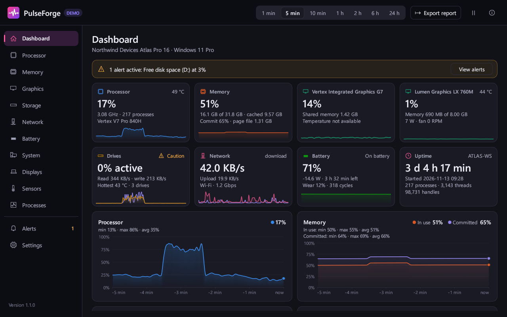

</div>

---

## ✨ Features

<table>
<tr>
<td width="50%" valign="top">

### 📊 Live dashboard
- Tiles and history graphs for processor, memory, graphics, drives, network and battery
- History from 1 minute to 24 hours, with minimum, maximum and average
- Pause the graphs to look closely
- Tray icon with a live number, and an optional always-on-top mini widget (double-click it to open the main window)
- Opens at the size and on the page you left it; keyboard shortcuts for every page

</td>
<td width="50%" valign="top">

### 🧠 Processor, memory, graphics
- Processor model, cores and threads, caches, features, per-core load and clock speed
- Memory in use, cached and committed, plus each module's size, speed, maker and slot
- Graphics adapters, driver, memory, per-engine load and per-process use

</td>
</tr>
<tr>
<td valign="top">

### 💽 Storage health
- Every drive: model, firmware, interface, partitions and volumes
- Whether each volume is encrypted with BitLocker
- **SMART and NVMe health** with plain-language status
- Temperature, power-on hours, total written, life remaining
- Live read and write rates

</td>
<td valign="top">

### 🔋 Battery, system, displays
- Battery: design and full capacity, wear, cycle count, charge rate, time left
- System: board, BIOS, Secure Boot, TPM, Windows edition and build
- **Copy summary**: the computer in a few lines for a message or forum post, with nothing identifying in it
- Displays: resolution, refresh rate, HDR, scaling
- Network adapters and rates

</td>
</tr>
<tr>
<td valign="top">

### 🌡️ Sensors and processes
- Every temperature the machine exposes without a driver
- Live process table sortable by processor, memory, disk and graphics use
- **Group by name**: one row per program with all its processes added up
- Details of the selected process: started by, user, running time, handles, graphics memory
- End a process, with confirmation

</td>
<td valign="top">

### 🔔 Alerts, logs, reports
- Alerts on temperature, usage, battery, free space and drive health, with a history that is kept between runs
- Logging to CSV, with optional clean-up of old files
- **Full system report** as HTML, text or JSON, with an option to mask serial numbers and names
- Celsius or Fahrenheit, dark and light themes

</td>
</tr>
</table>

## 🖼️ Screenshots

<table>
<tr>
<td width="50%" align="center"><b>Processor</b><br>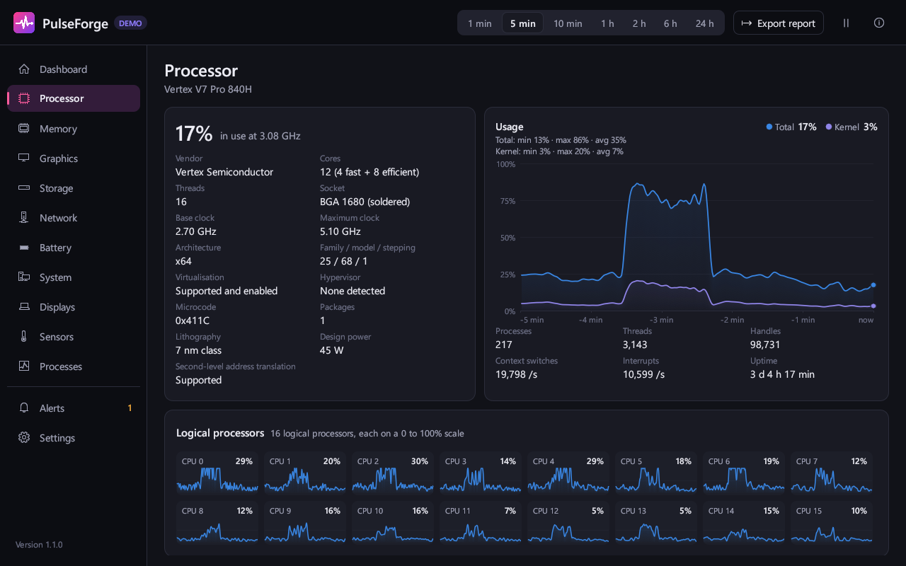</td>
<td width="50%" align="center"><b>Memory</b><br></td>
</tr>
<tr>
<td width="50%" align="center"><b>Drive health</b><br>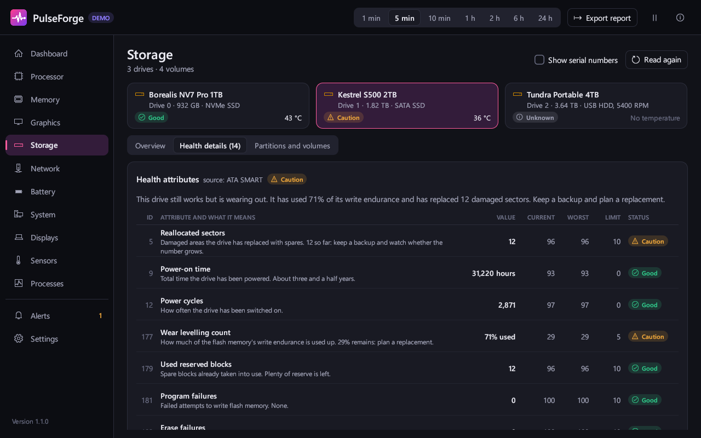</td>
<td width="50%" align="center"><b>Battery</b><br>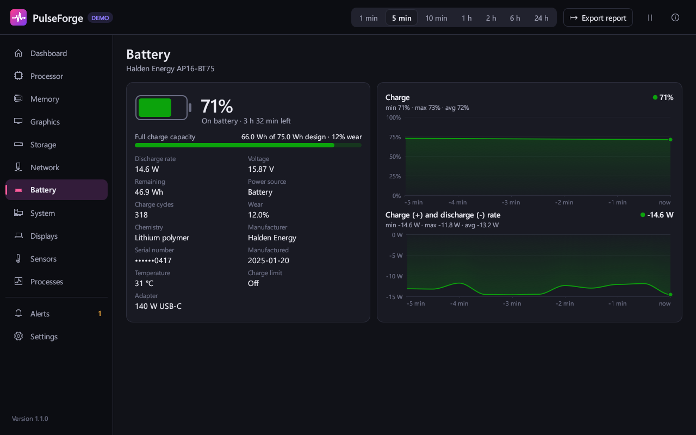</td>
</tr>
<tr>
<td width="50%" align="center"><b>Graphics</b><br>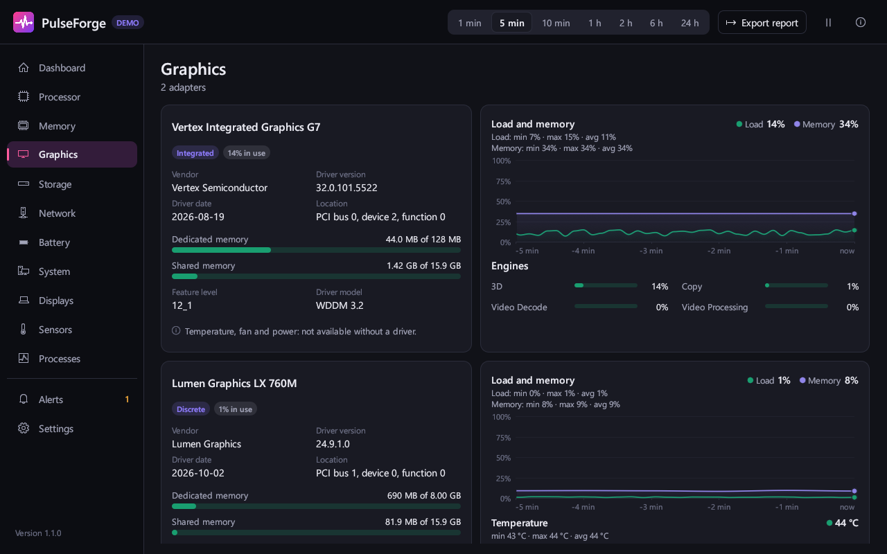</td>
<td width="50%" align="center"><b>Processes</b><br>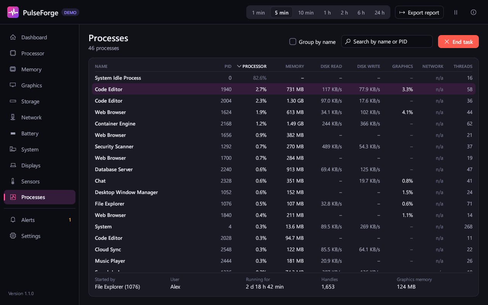</td>
</tr>
<tr>
<td width="50%" align="center"><b>Sensors</b><br>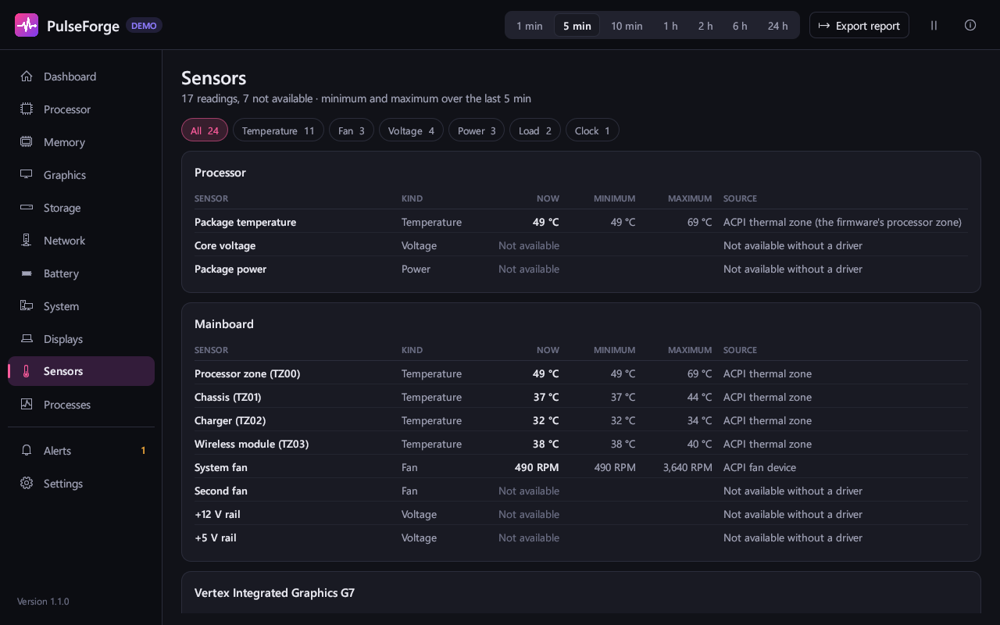</td>
<td width="50%" align="center"><b>Alerts</b><br>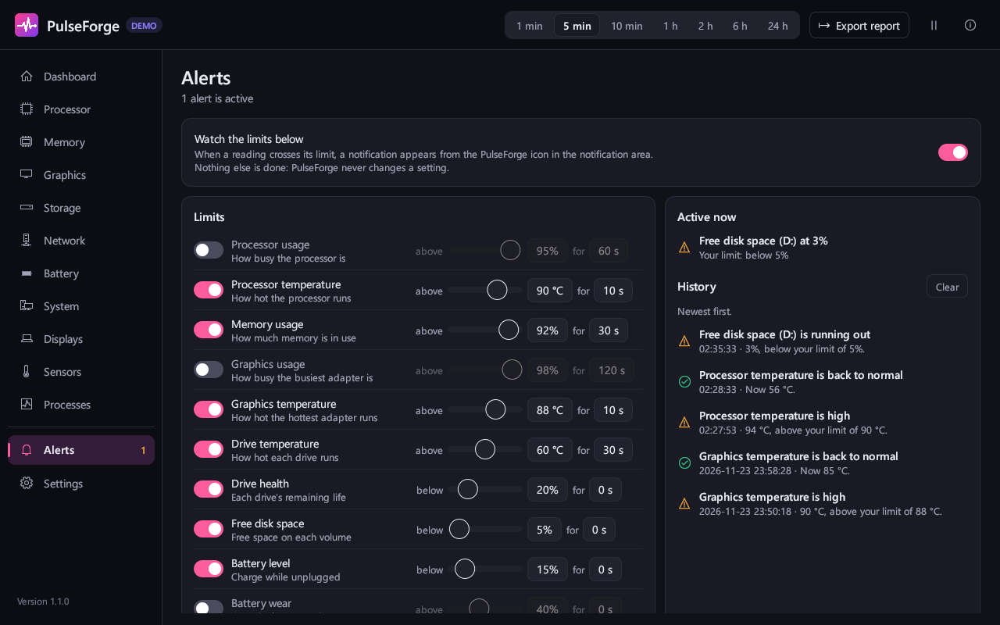</td>
</tr>
<tr>
<td width="50%" align="center"><b>System</b><br>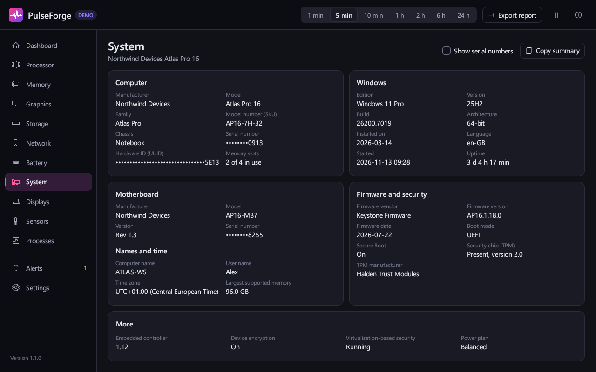</td>
<td width="50%" align="center"><b>Light theme</b><br>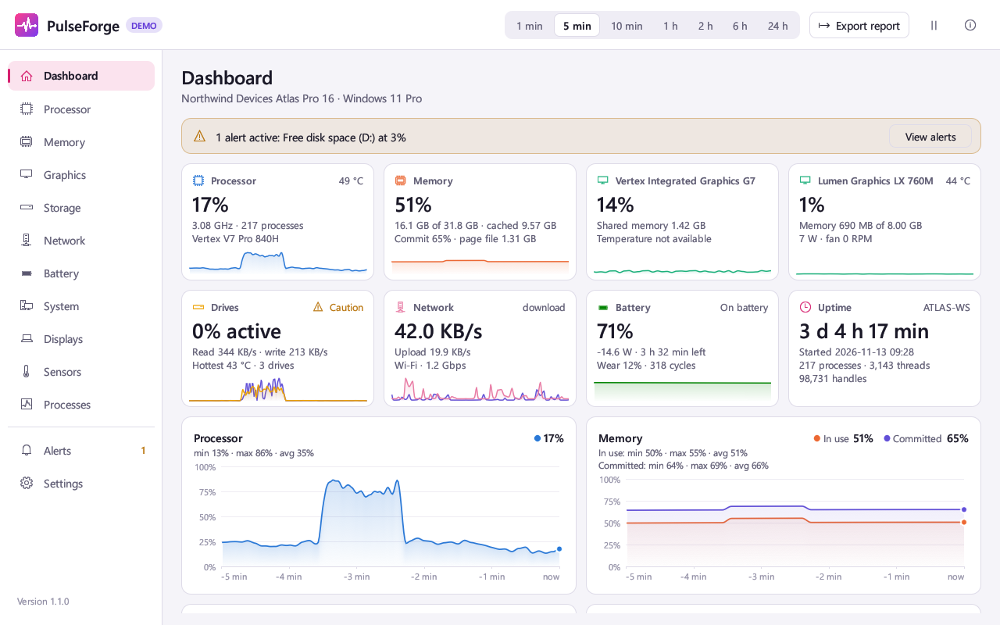</td>
</tr>
<tr>
<td width="50%" align="center"><b>Processes, grouped by name</b><br>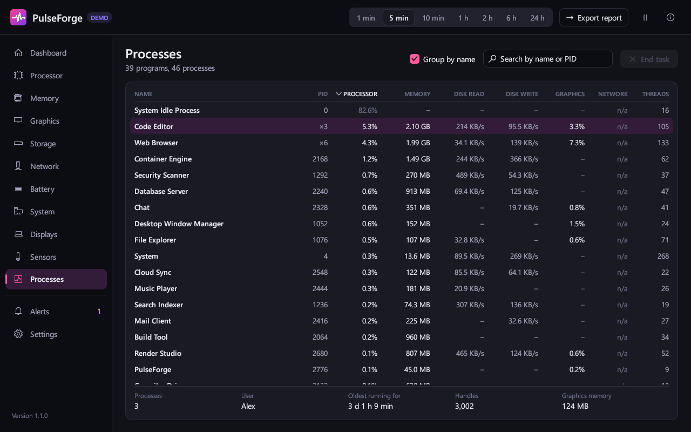</td>
<td width="50%" align="center"><b>Volumes and encryption</b><br>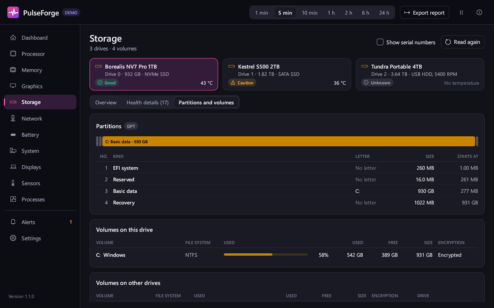</td>
</tr>
</table>

<sub>Screenshots use the built-in demo mode (<code>PulseForge.exe --demo</code>), with invented hardware.</sub>

## 📥 Download

Get it from the [**latest release**](https://github.com/zheerkhalid/pulseforge/releases/latest):

| File | What it is |
|---|---|
| `PulseForge-Setup.exe` | Per-user installer with shortcuts and an uninstaller |
| `PulseForge-x.y.z-portable-x64.zip` | Portable: unzip and run |
| `PulseForge.exe` | The bare 5.2 MB EXE |

PulseForge runs without administrator rights. Running as administrator unlocks SMART data on some drives.

Only one copy runs at a time: starting PulseForge again brings up the window of the copy that is already running.

What changed in each version is in the [**changelog**](CHANGELOG.md).

It is light: well under 0.1 % of the machine while in the tray, and under half a percent with the window open, measured on a 16-thread laptop.

## 🚫 What it cannot read

PulseForge installs **no kernel driver**, which keeps it safe and simple but puts some readings out of reach on most PCs. It shows these as "not available without a driver" and never invents a value:

- Per-core processor temperatures (it shows the system's thermal zone instead, labelled as such)
- Fan speeds and voltages
- Per-process network use

Also not in this version: graphics temperature and power unless the vendor's own library is installed, battery temperature and drive rotation speed.

Good to know:

- The BitLocker state is what Windows itself reports for a mounted volume ("Encrypted" also covers a volume that is locked, suspended or still being encrypted). Volumes for which Windows says nothing show "Unknown".
- Grouping processes adds up the numbers of processes that share a name; to end one of them, untick "Group by name" first.
- The window size is remembered for an ordinary window, not for a maximised one, and the window position is left to Windows.

PulseForge only reads. It never changes power plans, fan curves or firmware; the one action it can take is ending a process you choose.

## ⌨️ Keyboard shortcuts

| Keys | What they do |
|---|---|
| `Ctrl+1` ... `Ctrl+0` | Open a page (in the order of the navigation) |
| `Ctrl+Tab`, `Ctrl+Shift+Tab` | Next and previous page |
| `Ctrl+F` | Search the processes |
| `Ctrl+E` | Export a report |
| `Ctrl+Shift+C` | Copy a summary of the computer |
| `Ctrl+M` | Mini widget on or off |
| `F5` | Read the hardware and the drives again |
| `Space` | Pause or resume the graphs |
| `Esc` | Close a dialog |

## 🏗️ Build from source

Requires Rust (stable, MSVC toolchain) on Windows.

```powershell
git clone https://github.com/zheerkhalid/pulseforge
cd pulseforge
cargo build --release
# -> target\release\PulseForge.exe
cargo test
```

| Command | What it does |
|---|---|
| `PulseForge.exe --demo` | Invented hardware and readings |
| `PulseForge.exe --tray` | Start in the tray |
| `PulseForge.exe --report out.html` | Write a system report without the window |
| `PulseForge.exe --selftest` | Run every reading once and say which worked |
| `PulseForge.exe --new-instance` | Open a second copy on purpose |

The icon is drawn in code at build time. The C runtime is linked statically, so the EXE runs on a clean Windows install.

## 👨‍💻 Developer

<table>
<tr>
<td align="center" width="140">
  <a href="https://zheer.dev">
    
  </a>
</td>
<td>

**Designed and developed by [Zheer Khalid](https://zheer.dev)**

🌐 Website: **[zheer.dev](https://zheer.dev)**  
🐙 GitHub: **[@zheerkhalid](https://github.com/zheerkhalid)**  
🧩 Also by Zheer: **[SnapForge](https://github.com/zheerkhalid/snapforge)**, **[ReelForge](https://github.com/zheerkhalid/reelforge)**, **[UnForge](https://github.com/zheerkhalid/unforge)**, **[KeepForge](https://github.com/zheerkhalid/keepforge)**, **[ShredForge](https://github.com/zheerkhalid/shredforge)**, **[BootForge](https://github.com/zheerkhalid/bootforge)**, **[WireForge](https://github.com/zheerkhalid/wireforge)**, **[TwinForge](https://github.com/zheerkhalid/twinforge)**, **[SpaceForge](https://github.com/zheerkhalid/spaceforge)**, **[RescueForge](https://github.com/zheerkhalid/rescueforge)**, **[FindForge](https://github.com/zheerkhalid/findforge)** and **[HourForge](https://github.com/zheerkhalid/hourforge)**

If PulseForge is useful to you, a ⭐ on the repo is appreciated.

</td>
</tr>
</table>

## 📄 License

MIT © 2026 [Zheer Khalid](https://zheer.dev). See [`LICENSE`](LICENSE).

<div align="center">
<sub>Built with 🦀 Rust and ❤️ by <a href="https://zheer.dev">zheer.dev</a></sub>
</div>
